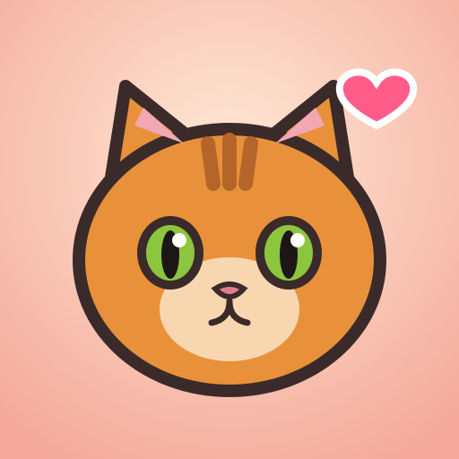

# Kattrummet

Ett mysigt kattrum i 3D för mobilen. Klappa katterna, lek med laserpekaren, se dem knuffa ner saker från bordet och inred rummet.

## Spela

- **Klappa:** dra fingret fram och tillbaka över en katt. Den spinner, darrar lite och trampar med tassarna. Snabba klapp i rad ger combo.
- **Tryck på en katt:** den rullar över på rygg med tassarna i luften. Klappa magen, men peta för många gånger och den fångar handen.
- **Laserpekare:** håll fingret på golvet. Katterna smyger, vickar på rumpan och kastar sig.
- **Knuffa saker:** tryck eller svep på saker på bordet, hyllan eller garnbollen.
- **Kamera:** dra i bakgrunden för att vrida rummet, nyp för att zooma.
- **Butik:** uppgraderingar och möbler som ger passiv inkomst och nya beteenden.
- **Katter:** adoptera upp till fem katter och ändra namn, päls och ögonfärg.
- **Foto:** ta en polaroid av rummet och dela den.
- **Mer:** ljud, tid på dygnet (följer riktig tid som standard) och statistik.

Spelet sparas lokalt i webbläsaren och katterna samlar ❤ även när du är borta (upp till 8 timmar).
Det går att installera som app via "Lägg till på hemskärmen".

## Utveckla

```sh
npm install --include=dev
npm run dev      # http://localhost:5173, nås även från telefonen på samma nät
npm test         # ekonomi- och sparlogik
npm run build    # statisk build i dist/
```

`--include=dev` behövs om `NODE_ENV=production` är satt i miljön.

## Teknik

Vite, TypeScript, Three.js och cannon-es. Allt i 3D är byggt i kod av enkla former med toon-shading och konturer,
och alla ljud syntetiseras med Web Audio, så det finns inga externa assets.

| Fil | Ansvar |
| --- | --- |
| `src/main.ts` | Ihopkoppling, spelloop, ekonomi, sparning |
| `src/cat/model.ts` | Kattmodell, pälsmönster, poser |
| `src/cat/cat.ts` | Katternas beteende (generator-baserade planer) |
| `src/scene/room.ts` | Rummet och möblerna |
| `src/scene/physics.ts` | Fysik för saker som kan knuffas ner |
| `src/game/` | Ren spellogik med tester |

## Publicera

`.github/workflows/deploy.yml` bygger och publicerar till GitHub Pages vid push till `development`
(slå på Pages med källan "GitHub Actions" i repots inställningar).
